# Entity-Relationship Diagram

> **Draft for Milestone 1.** The database itself is built in Milestone 2; this diagram
> is updated to match the `.sql` file then. A picture of the same diagram is in
> [erd.svg](erd.svg) (and [erd.png](erd.png)).

```mermaid
erDiagram
    users ||--o{ production_runs : logs
    users ||--o{ conversion_runs : logs
    users ||--o{ maintenance_records : logs

    machines ||--o{ machine_parameters : measures
    machines ||--o{ machine_products : "works with"
    products ||--o{ machine_products : "is used or made on"
    machines ||--o{ production_runs : "runs"
    machines ||--o{ conversion_runs : "runs"
    machines ||--o{ maintenance_records : "is serviced in"

    recipes ||--o{ recipe_items : contains
    materials ||--o{ recipe_items : "is part of"
    recipes ||--o{ recipe_products : "is used for"
    products ||--o{ recipe_products : "is made with"

    products ||--o{ production_runs : "is produced in"
    recipes ||--o{ production_runs : "is mixed in"
    production_runs ||--o{ run_parameter_values : records
    machine_parameters ||--o{ run_parameter_values : "is measured in"
    production_runs ||--o{ material_usages : consumes
    materials ||--o{ material_usages : "is consumed in"

    products ||--o{ conversion_runs : "is the input of"
    products ||--o{ conversion_runs : "is the output of"
    conversion_runs ||--o{ conversion_run_parameter_values : records
    machine_parameters ||--o{ conversion_run_parameter_values : "is measured in"

    users {
        int id PK
        varchar full_name
        varchar email UK "used to log in"
        varchar password_hash
        enum role "admin | operator, default operator"
        boolean is_active
        datetime created_at
    }

    machines {
        int id PK
        varchar name
        varchar code UK "e.g. EX-01"
        enum machine_type "extrusion | conversion"
        boolean is_active
        datetime created_at
    }

    machine_parameters {
        int id PK
        int machine_id FK
        varchar name "unique per machine"
        varchar unit "nullable, e.g. rpm"
        int display_order
    }

    products {
        int id PK
        varchar code UK
        varchar name
        int width_mm "nullable"
        int thickness_um "nullable"
        decimal length_m "nullable"
        enum unit "kg | pcs"
        varchar description "nullable"
        boolean is_active
    }

    machine_products {
        int id PK
        int machine_id FK
        int product_id FK
        enum role "input | output; unique with machine and product"
    }

    materials {
        int id PK
        varchar name UK
        varchar unit "kg"
        varchar supplier "nullable"
        decimal stock_qty "never below 0"
        decimal min_stock_qty "nullable: no low-stock warning"
        boolean is_active
    }

    recipes {
        int id PK
        varchar name
        varchar notes "nullable"
        boolean is_active
    }

    recipe_items {
        int id PK
        int recipe_id FK
        int material_id FK
        decimal percentage "over 0, at most 100; unique per recipe and material"
    }

    recipe_products {
        int id PK
        int recipe_id FK
        int product_id FK
        boolean is_default "default recipe for this product"
    }

    production_runs {
        int id PK
        int machine_id FK "an extrusion machine"
        int product_id FK
        int recipe_id FK
        int user_id FK "who logged it"
        datetime started_at
        datetime warmup_started_at "nullable"
        datetime stable_at "nullable: production became stable"
        datetime ended_at "after started_at"
        decimal quantity_produced "in the product's unit"
        decimal net_weight_per_unit_kg "nullable"
        decimal gross_weight_per_unit_kg "nullable"
        decimal scrap_kg
        text notes "nullable"
        datetime created_at
        datetime updated_at
    }

    run_parameter_values {
        int id PK
        int production_run_id FK "deleted with the run"
        int machine_parameter_id FK
        decimal value "one per parameter per run"
    }

    material_usages {
        int id PK
        int production_run_id FK "deleted with the run"
        int material_id FK
        decimal quantity_kg "one row per material per run"
    }

    conversion_runs {
        int id PK
        int machine_id FK "a conversion machine"
        int user_id FK "who logged it"
        int input_product_id FK "film"
        int output_product_id FK "bags"
        datetime started_at
        datetime ended_at "after started_at"
        decimal input_kg
        decimal output_kg "at most input_kg; scrap = input - output"
        int bag_count
        text notes "nullable"
        datetime created_at
        datetime updated_at
    }

    conversion_run_parameter_values {
        int id PK
        int conversion_run_id FK "deleted with the conversion"
        int machine_parameter_id FK
        decimal value "one per parameter per conversion"
    }

    maintenance_records {
        int id PK
        int machine_id FK
        int user_id FK "who logged it"
        enum maintenance_type "preventive | corrective"
        datetime started_at
        datetime ended_at "not before started_at"
        text description "work done"
        text notes "nullable: spare parts"
        datetime created_at
        datetime updated_at
    }
```

## Reading the diagram

`||--o{` means "one to many": one machine has zero or more runs. The three link tables
with extra data turn many-to-many relationships into two one-to-many ones:

| Many-to-many | Link table | Extra data on the link |
|---|---|---|
| machines and products | `machine_products` | role: input or output |
| recipes and materials | `recipe_items` | percentage |
| recipes and products | `recipe_products` | default recipe for the product |
| production runs and machine parameters | `run_parameter_values` | measured value |
| production runs and materials | `material_usages` | kilograms used |
| conversion runs and machine parameters | `conversion_run_parameter_values` | measured value |

`conversion_runs` references `products` twice, once for the film that went in and once
for the bags that came out.

## Design notes

- **Ids** are whole numbers (`INT AUTO_INCREMENT`), the same ids the frontend reads from
  addresses such as `#run-detail?id=17`.
- **Quantities** use `DECIMAL`, not `FLOAT`, so stock added up over months does not drift.
- **Master data is deactivated, not deleted** (`is_active` on users, machines, products,
  materials and recipes): old runs keep pointing at the machine, product and recipe they
  used. Runs, conversions and maintenance records can be deleted; their parameter values
  and material usages are deleted with them.
- **Scrap of a conversion is not stored**: it is always input minus output.
- **There is no deliveries table**: a delivery only adds to `materials.stock_qty`.

## Rules the database cannot check

Foreign keys and checks protect one table at a time. These rules span several tables, so
the backend services enforce them (Milestone 3):

- A production run's machine is an extrusion machine; a conversion's machine is a
  conversion machine.
- A run's product is linked to its machine as an output; a conversion's input and output
  products are linked to its machine as input and output.
- Parameter values belong to parameters of the run's own machine.
- A recipe's percentages add up to 100.
- Material stock goes down by a run's usages, changes by the difference when a usage is
  edited, and comes back when a run is deleted.
